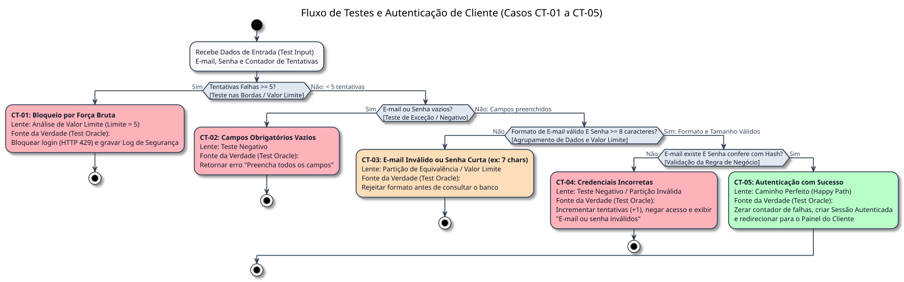

# **Roteiro do Trabalho e Reengenharia e Implementação de Testes de Software**

**Instituição:** Faculdade de Tecnologia (FATEC)  
 **Curso:** Superior de Tecnologia em Análise e Desenvolvimento de Sistemas (ADS)  
 **Disciplina:** Teste de Software  
 **Repositório de Referência:** `https://github.com/Wattrelos/FATEC-FV_Teste_Software_aula-008`  
 **Modalidade:** Continuidade de Trabalho em Equipes (5 Grupos já definidos: A, B, C, D e E)  
 **Regra Técnica Fundamental (Sem PHP na Execução):** Os arquivos `.php` do repositório base servem **exclusivamente como fonte de consulta e engenharia reversa (leitura)** nas Fases 1 e 2\. Nas Fases 3 e 4 (Laboratório), cada grupo deverá reproduzir e demonstrar os testes funcionando em **outra linguagem de programação de domínio da equipe (sem utilizar PHP**, ex.: Python com `pytest`/`unittest`, JavaScript/TypeScript com `Jest`/Node, Java com `JUnit` ou C\# com `xUnit`).  
 **Cronograma por Fases:**

* **Fases 1 e 2 (Remoto: 06/11 e 13/11 até 19/11 às 23h59, Via Teams):** Construção da planilha de testes do grupo (10 colunas), leitura estática dos arquivos do repositório (com apoio de IA), preenchimento das Colunas **A até G**, especificação de 2 novos cenários e elaboração do **Diagrama de Fluxo de Testes em PlantUML** (sem necessidade de programar nesta etapa).  
* **Fases 3 e 4 (Preparação: 23/11 até 27/11. Entrega, Apresentação e Feedback avaliativo em Laboratório em 27/11, com vista das notas das entregas):** Reprodução e execução prática dos testes na linguagem escolhida pelo grupo (**sem PHP**), preenchimento das Colunas **H, I e J** da planilha (atividade aberta no Teams), com apresentação funcionando em laboratório, feedback avaliativo, **vista das notas das entregas no dia 27/11**.

---

## **1\. Objetivo Pedagógico**

Dar continuidade ao trabalho dos 5 grupos (iniciado em 06/11) aplicando os seguintes conceitos fundamentais de **Teste de Software** : *"Roteiro de Verificação" (Test Case, Caso de Teste), "Fonte da Verdade" (Test Oracle, Oráculo de Teste), "Caminho Perfeito" (Happy Path, Caminho Feliz), "Teste de Exceção" (Negative Testing, Teste Negativo), "Agrupamento de Dados" (Equivalence Partitioning, Partição de Equivalência), "Teste nas Bordas" (Boundary Value Analysis, Análise de Valor Limite) e "Prova de Execução" (Test Evidence, Evidência de Teste)*, por meio da engenharia reversa do repositório, modelagem visual em **PlantUML** (até 19/11) e **preparação/apresentação prática dos testes funcionando em outra linguagem (sem PHP) em laboratório no dia 27/11, com feedback avaliativo, vista das notas das entregas**.

---

## **2\. Fundamentação Conceitual de Consulta Rápida**

Para a realização desta atividade, cada grupo deverá analisar os arquivos de referência designados identificando os seguintes elementos estruturais da Engenharia de Qualidade de Software (QA):

1. **"Roteiro de Verificação" (*Test Case*, Caso de Teste):** Conjunto de condições, dados de entrada, passos de execução e resultados esperados desenvolvido para validar um requisito ou comportamento específico do sistema.  
2. **"Dados de Entrada e Contexto" (*Test Input / Preconditions*, Entrada e Pré-condição):** Os dados fornecidos ao sistema ou a ação disparada pelo usuário/script durante o teste (no código, representados pela preparação de variáveis ou cláusulas `Given`/`When` , `Dado`/`Quando`).  
3. **"Fonte da Verdade" (*Test Oracle*, Oráculo de Teste / Resultado Esperado):** O mecanismo, critério ou regra de negócio que determina se o sistema passou ou falhou no teste (representado nas linguagens por instruções de asserção como `assert`, `assertEquals`, `expect`, ou cláusulas `Then` , `Então`).  
4. **Técnicas e Perspectivas de Teste:**  
   * **"Caminho Perfeito" (*Happy Path*, Caminho Feliz):** Valida o fluxo principal com entradas válidas, esperando o sucesso da operação.  
   * **"Teste de Exceção/Sabotagem" (*Negative Testing*, Teste Negativo):** Submete entradas inválidas, incompletas ou ações não autorizadas para verificar se o sistema trata erros e rejeita a operação de forma segura.  
   * **"Agrupamento de Dados" (*Equivalence Partitioning*, Partição de Equivalência):** Divide o domínio de dados de entrada em classes (partições) válidas e inválidas, selecionando um representante de cada classe para teste.  
   * **"Teste nas Bordas" (*Boundary Value Analysis*, Análise de Valor Limite):** Avalia o comportamento do software exatamente nas fronteiras das regras de negócio (ex.: limites mínimos e máximos de caracteres, tempo de expiração de sessão ou número máximo de tentativas antes do bloqueio).  
5. **"Prova de Execução" (*Test Evidence*, Evidência de Teste):** Registro comprovando a execução do teste (captura de tela ou log de saída do terminal na linguagem escolhida pelo grupo) que demonstra o **Resultado Obtido**.  
6. **Modelagem do Fluxo de Testes com PlantUML:** Representação visual em texto (`@startuml ... @enduml`) ilustrando as decisões da regra de negócio do grupo (mostrando onde o fluxo segue pelo *Caminho Feliz* e onde é barrado pelos *Testes Negativos* ou *Valores Limite*). Pode ser gerado gratuitamente no navegador via `https://www.planttext.com/`.

---

## **3\. Estrutura Obrigatória da Planilha de Registro (Construção pelo Grupo)**

IMPORTANT

**Não será fornecido um arquivo `.xlsx` pronto.** Na etapa remota (**06/11 e 13/11 até 19/11 às 23h59**), cada grupo deve criar, estruturar e preencher as **Colunas A até G** da sua própria planilha eletrônica intitulada `Registro_Execucao_Testes_Login_Grupo_[Letra].xlsx` (além de uma aba ou anexo contendo o **Diagrama PlantUML** do grupo). As **Colunas H, I e J** devem ser preenchidas no período de **23/11 até 27/11** para apresentação e feedback avaliativo em laboratório no dia **27/11 (com vista das notas das entregas)**.

A planilha criada pelo grupo deve conter obrigatoriamente uma aba principal chamada **`Execucao_Testes`** com as **10 colunas** especificadas abaixo:

| Col. | Nome Técnico | Descrição do Preenchimento | Prazo / Fase | Exemplo de Preenchimento |
| ----- | ----- | ----- | :---: | ----- |
| **A** | **"Código Identificador" (*Test Case ID*, ID do Caso de Teste)** | Código único sequencial identificando o grupo e o teste. | Fase 1 (06–13/11 até 19/11) | `CT-A01`, `CT-B01`, `CT-C01` |
| **B** | **"Local do Código" (*Source File*, Arquivo de Origem)** | Caminho do arquivo de referência no repositório (ou o nome do arquivo criado pelo grupo sem PHP / `NOVO`). | Fase 1 (06–13/11 até 19/11) | `Ref: LoginActionTest.php -> Novo: test_login.py` |
| **C** | **"Função no Código" (*Test Method / Scenario*, Método ou Cenário de Teste)** | Nome original do método de referência ou da função equivalente criada pelo grupo. | Fase 1 (06–13/11 até 19/11) | `test_login_with_invalid_password_returns_error` |
| **D** | **"Regra Verificada" (*Test Objective*, Objetivo do Teste)** | Tradução clara, em português formal, do que o teste valida na prática. | Fase 2 (06–13/11 até 19/11) | Validar que o sistema recusa a autenticação quando a senha informada diverge da cadastrada. |
| **E** | **"Cenário e Entradas" (*Preconditions & Inputs*, Pré-condições e Dados de Entrada)** | Estado inicial necessário e valores utilizados no teste. | Fase 2 (06–13/11 até 19/11) | Usuário cadastrado ativo; e-mail válido; senha incorreta (`"SenhaErrada123"`). |
| **F** | **"Lente de Teste" (*Test Design Technique*, Técnica de Teste)** | Conceito técnico aplicado no teste. | Fase 2 (06–13/11 até 19/11) | `Teste Negativo` / `Partição de Equivalência` |
| **G** | **"Fonte da Verdade" (*Test Oracle / Expected Result*, Oráculo de Teste / Resultado Esperado)** | Comportamento exato exigido pela regra de negócio (o que a asserção do código cobra). | Fase 2 (06–13/11 até 19/11) | Retornar erro de credenciais inválidas e não iniciar sessão. |
| **H** | **"Comportamento Real" (*Actual Result*, Resultado Obtido)** | Comportamento observado durante a execução prática do código (sem PHP). | Fase 3 (23/11 até 27/11) | Acesso negado e mensagem de erro exibida conforme esperado. |
| **I** | **"Veredito" (*Execution Status*, Status de Execução)** | Situação final do caso de teste (`Passou`, `Falhou`, `Bloqueado` ou `Proposto`). | Fase 3 (23/11 até 27/11) | `Passou` |
| **J** | **"Prova de Execução" (*Test Evidence / Traceability*, Evidência e Rastreabilidade)** | Linha do código implementado pelo grupo, log do terminal (ex.: Pytest/Jest/JUnit) ou print. | Fases 3 e 4 (23/11 até 27/11) | `test_login.py (L15-L28) / Log Pytest PASSED` |

---

## **4\. Roteiro da Atividade em 4 Fases**

### **Fase 1: Construção da Planilha e Mapeamento Inicial (Remoto: 06/11 e 13/11 até 19/11 às 23h59 via Teams)**

* **1.1 Divisão Interna dos Arquivos:** Com o grupo já formado, distribuir os arquivos de referência atribuídos à equipe entre os integrantes.  
* **1.2 Construção da Planilha do Grupo:** Criar a planilha `Registro_Execucao_Testes_Login_Grupo_[Letra].xlsx` com as **10 colunas da Seção 3** e cadastrar nas Colunas **A, B e C** todos os testes identificados nos arquivos do escopo do grupo.

### **Fase 2: Engenharia Reversa, Novos Casos e Diagrama PlantUML (Remoto: 06/11 e 13/11 até 19/11 às 23h59 via Teams)**

* **2.1 Tradução Funcional (Sem programar o sistema; permitido apoio de IA):** Ler os arquivos do repositório atribuídos ao grupo apenas como especificação para extrair as regras de negócio e preencher as Colunas **D, E, F e G** (*Objetivo, Dados de Entrada, Técnica de Teste e "Fonte da Verdade"*).  
* **2.2 Proposição de 2 Novos Casos de Teste:** Especificar na planilha 2 cenários adicionais (marcados como `NOVO` na Coluna B) que ampliem a cobertura de riscos da camada estudada.  
* **2.3 Modelagem Visual com PlantUML:** Criar **1 (um) diagrama em PlantUML** (Diagrama de Atividades, Sequência ou Estados) representando o fluxo de decisão e os caminhos de teste (Caminho Feliz vs. Testes Negativos/Limites) da camada do grupo, anexando o código `@startuml ... @enduml` e a imagem gerada em uma aba da planilha ou documento do grupo.

#### **Exemplo Prático de Cenário para o Diagrama PlantUML (Autenticação e Segurança de Login)**

* **Regra de Negócio Mapeada:** O sistema de Login deve verificar: (1) se o IP/usuário já atingiu o limite máximo de **5 tentativas falhas consecutivas** (*Análise de Valor Limite*); (2) se o e-mail e a senha foram preenchidos e possuem formato válido, com senha de no mínimo **8 caracteres** (*Partição de Equivalência / Valor Limite*); e (3) se as credenciais conferem com o cadastro para liberar a sessão (*Caminho Feliz*) ou rejeitar registrando log de auditoria (*Teste Negativo*).

### **Fase 3: Preparação e Implementação Sem PHP (Preparação: 23/11 até 27/11)**

> * **3.1 Implementação e Execução (Sem PHP):** A partir de **23/11**, reproduzir os testes mapeados pelo grupo (e os 2 novos cenários) em uma linguagem escolhida pela equipe (**sem utilizar PHP** , ex.: Python com `pytest`, JavaScript com `Jest`, Java com `JUnit` ou C\# com `xUnit`).

>    **Orientação Técnica Importante para a Fase 3 (Como implementar sem complicação):**

>   * **Para os Grupos B, C, D e E:** Vocês **não precisam** recriar um servidor web completo, banco de dados ou telas HTML para rodar os testes. Basta criar pequenas funções ou classes isoladas na linguagem escolhida que reproduzam a regra de negócio extraída na engenharia reversa (ex.: `autenticar_usuario()`, `validar_email()`, `verificar_sessao_ativa()`, `verificar_limite_tentativas()`) e escrever os testes automatizados chamando diretamente essas funções para validar as Entradas e a **"Fonte da Verdade"** (*Test Oracle*).  
>   * **Para o Grupo A:** Como os arquivos `features/login.feature`, `features/steps/login_steps.py` e `test_playwright_telas.py` já estão escritos em Gherkin e Python (naturalmente sem PHP), o grupo pode focar em executar e expandir diretamente os cenários comportamentais/E2E validando as telas HTML (`public/*.html`) ou um protótipo simples.  
* **3.2 Coleta de Evidências na Planilha:** Preencher as Colunas **H, I e J** (*Comportamento Real, Veredito e Prova de Execução*) com os resultados e logs obtidos na execução do código.

### **Fase 4 (Última Fase): Entrega, Apresentação e Feedback avaliativo em Laboratório em 27/11 (com vista das notas das entregas)**

* **4.1 Entrega Final no Teams (Até 27/11):** Com a atividade aberta no Teams, anexar a planilha preenchida (10 colunas), o **Diagrama PlantUML** e os códigos de teste implementados.  
* **4.2 Apresentação Funcionando no Laboratório, Vista das Notas das Entregas (27/11):** No encontro presencial do dia **27/11 (com vista das notas das entregas)**, apresentar o código implementado pelo grupo (sem PHP) com os exemplos funcionando ao vivo no laboratório e receber o feedback avaliativo das entregas (apontando na tela onde estão os **Dados de Entrada**, a **Técnica de Teste** e a **"Fonte da Verdade"**, *Test Oracle* / `assert`).

---

## **5\. Distribuição de Escopo e Checklists por Grupo**

### **Grupo A: Camada de Apresentação e Comportamento (BDD e Testes E2E)**

* **Volume Estimado:** 11 casos de teste  
* **Arquivos de Referência:** `features/login.feature` e `test_playwright_telas.py` (apoio: `features/steps/login_steps.py`)  
* **Foco Conceitual:** "Caminho Perfeito" (*Happy Path*, Caminho Feliz), "Teste de Exceção" (*Negative Testing*, Teste Negativo) e "Teste de Ponta a Ponta" (*End-to-End / Black-Box*, Caixa-Preta).  
* **Como Executar nas Fases 3 e 4:** Como seus arquivos já são em Python/Gherkin (sem PHP), execute/adapte os cenários `behave`/`playwright` diretamente sobre as telas HTML (`public/*.html`) ou interface equivalente, adicionando os 2 novos cenários propostos.  
* **Checklist por Fases. Grupo A:**  
  * **Fases 1 e 2 (Remoto: 06/11 e 13/11 até 19/11 às 23h59, via Teams):** Planilha de 10 colunas (Colunas A a G), 2 novos cenários e Diagrama PlantUML concluídos.  
  * **Fases 3 e 4 (Preparação: 23/11 até 27/11, Entrega, Apresentação e Feedback avaliativo em Laboratório em 27/11 com vista das notas das entregas):** Execução em Python/BDD/Playwright validada, Colunas H, I e J preenchidas, com apresentação funcionando em laboratório, feedback avaliativo, vista das notas das entregas no dia **27/11**.

---

### **Grupo B: Camada de Aplicação e Regras de Negócio (Autenticação)**

* **Volume Estimado:** 12 casos de teste  
* **Arquivos de Referência para Leitura (Engenharia Reversa):** `tests/Unit/Application/AuthenticateCustomerUseCaseTest.php` e `tests/Integration/LoginActionTest.php`  
* **Foco Conceitual:** "Agrupamento de Dados" (*Equivalence Partitioning*, Partição de Equivalência) e "Fonte da Verdade" (*Test Oracle*, Oráculo de Teste de Regra de Negócio).  
* **Como Executar nas Fases 3 e 4 (Sem PHP):** Crie uma função/classe simples de autenticação na linguagem escolhida (ex.: `autenticar_cliente(email, senha)` com usuários simulados em memória/dicionário) e implemente os 12 testes \+ 2 novos cenários validando credenciais corretas, incorretas e inexistentes.  
* **Checklist por Fases. Grupo B:**  
  * **Fases 1 e 2 (Remoto: 06/11 e 13/11 até 19/11 às 23h59, via Teams):** Planilha de 10 colunas (Colunas A a G), 2 novos cenários e Diagrama PlantUML concluídos.  
  * **Fases 3 e 4 (Preparação: 23/11 até 27/11, Entrega, Apresentação e Feedback avaliativo em Laboratório em 27/11, com vista das notas das entregas):** Reprodução dos testes sem PHP, preenchimento das Colunas H, I e J, com apresentação funcionando em laboratório, feedback avaliativo, vista das notas das entregas no dia **27/11**.

---

### **Grupo C: Camada de Domínio e Sanitização (Validação de Entradas e Limites)**

* **Volume Estimado:** 12 casos de teste  
* **Arquivos de Referência para Leitura (Engenharia Reversa):** `tests/Unit/Domain/EmailTest.php`, `tests/Unit/Domain/PasswordHashTest.php` e `tests/Integration/InputSanitizationTest.php`  
* **Foco Conceitual:** "Teste nas Bordas" (*Boundary Value Analysis*, Análise de Valor Limite de tamanhos mínimos e máximos), "Agrupamento de Dados" (*Equivalence Partitioning*, Partição de Equivalência) e Sanitização de Entrada.  
* **Como Executar nas Fases 3 e 4 (Sem PHP):** Crie funções isoladas de validação/limpeza na linguagem escolhida (ex.: `validar_email()`, `validar_senha()`, `sanitizar_entrada()`) e implemente os 12 testes \+ 2 novos cenários testando os limites mínimos, máximos e formatos inválidos.  
* **Checklist por Fases. Grupo C:**  
  * **Fases 1 e 2 (Remoto: 06/11 e 13/11 até 19/11 às 23h59, via Teams):** Planilha de 10 colunas (Colunas A a G), 2 novos cenários e Diagrama PlantUML concluídos.  
  * **Fases 3 e 4 (Preparação: 23/11 até 27/11, Entrega, Apresentação e Feedback avaliativo em Laboratório em 27/11, com vista das notas das entregas):** Reprodução dos testes sem PHP, preenchimento das Colunas H, I e J, com apresentação funcionando em laboratório, feedback avaliativo, vista das notas das entregas no dia **27/11**.

---

### **Grupo D: Gerenciamento de Estado, Sessão e Ciclo de Vida (Logout)**

* **Volume Estimado:** 10 casos de teste  
* **Arquivos de Referência para Leitura (Engenharia Reversa):** `tests/Unit/Infrastructure/SessionConfigTest.php`, `tests/Integration/CustomerAuthMiddlewareTest.php` e `tests/Integration/LogoutActionTest.php`  
* **Foco Conceitual:** "Teste nas Bordas do Tempo" (*Temporal Boundary Value Analysis*, Análise de Valor Limite Temporal por inatividade) e "Mudança de Situação" (*State Transition Testing*, Teste de Transição de Estado: Autenticado vs. Não Autenticado).  
* **Como Executar nas Fases 3 e 4 (Sem PHP):** Crie uma classe/objeto simples de controle de sessão em memória (ex.: `GerenciadorSessao` com tempo de inatividade, estado logado/deslogado e função `logout()`) e implemente os 10 testes \+ 2 novos cenários validando expiração por tempo e bloqueio após saída.  
* **Checklist por Fases. Grupo D:**  
  * **Fases 1 e 2 (Remoto: 06/11 e 13/11 até 19/11 às 23h59, via Teams):** Planilha de 10 colunas (Colunas A a G), 2 novos cenários e Diagrama PlantUML concluídos.  
  * **Fases 3 e 4 (Preparação: 23/11 até 27/11, Entrega, Apresentação e Feedback avaliativo em Laboratório em 27/11, com vista das notas das entregas):** Reprodução dos testes sem PHP, preenchimento das Colunas H, I e J, com apresentação funcionando em laboratório, feedback avaliativo, vista das notas das entregas no dia **27/11**.

---

### **Grupo E: Controles de Segurança, Limite de Tentativas e Auditoria**

* **Volume Estimado:** 12 casos de teste  
* **Arquivos de Referência para Leitura (Engenharia Reversa):** `tests/Integration/RateLimitTest.php`, `tests/Integration/CsrfProtectionTest.php`, `tests/Integration/SecurityHeadersTest.php` e `tests/Unit/Infrastructure/SecurityLoggerTest.php`  
* **Foco Conceitual:** "Teste nas Bordas de Contagem" (*Boundary Value Analysis*, Análise de Valor Limite no bloqueio após NNN tentativas consecutivas), Proteção de Requisições e "Fonte da Verdade de Auditoria" (*Test Oracle*, Oráculo de Teste em Logs de Segurança).  
* **Como Executar nas Fases 3 e 4 (Sem PHP):** Crie funções/classes simples simulando o contador de tentativas, validação de token CSRF, cabeçalhos e registro de logs (ex.: `ControladorTentativas`, `RegistradorSeguranca`) e implemente os 12 testes \+ 2 novos cenários validando o bloqueio exatamente no limite de tentativas e a geração dos registros de auditoria.  
* **Checklist por Fases. Grupo E:**  
  * **Fases 1 e 2 (Remoto: 06/11 e 13/11 até 19/11 às 23h59, via Teams):** Planilha de 10 colunas (Colunas A a G), 2 novos cenários e Diagrama PlantUML concluídos.  
  * **Fases 3 e 4 (Preparação: 23/11 até 27/11, Entrega, Apresentação e Feedback avaliativo em Laboratório em 27/11, com vista das notas das entregas):** Reprodução dos testes sem PHP, preenchimento das Colunas H, I e J, com apresentação funcionando em laboratório, feedback avaliativo, vista das notas das entregas no dia **27/11**.

---

## **6\. Critérios de Avaliação por Fase**

| Fase / Prazo | Critério | Peso | Descrição |
| :--- | ----- | :---: | ----- |
| **Fase 1 (Remoto: 06/11 e 13/11 até 19/11, 23h59)** | **Estruturação da Planilha** | 1,5 | Criação da planilha pelo grupo com as 10 colunas padronizadas e mapeamento completo dos arquivos/métodos (Colunas A, B e C). |
| **Fase 2 (Remoto: 06/11 e 13/11 até 19/11, 23h59)** | **Engenharia Reversa, Novos Casos e PlantUML** | 2,5 | Tradução precisa em linguagem de negócio (Colunas D a G), classificação técnica, 2 novos cenários e Diagrama de Fluxo em **PlantUML**. |
| **Fase 3 (Preparação: 23/11 até 27/11)** | **Reprodução Sem PHP e Evidências** | 2,5 | Implementação dos testes em linguagem sem PHP e preenchimento completo das Colunas H, I e J (Comportamento Real, Veredito e Evidências). |
| **Fase 4 (23/11 até 27/11, Entrega, Apresentação e Feedback avaliativo em Laboratório em 27/11, com vista das notas das entregas)** | **Entrega, Apresentação e Feedback Avaliativo** | 3,5 | Entrega final, demonstração prática funcionando no laboratório, feedback avaliativo, vista das notas das entregas no dia **27/11**, explicando Entrada, Técnica e "Fonte da Verdade" (*Test Oracle*). |

